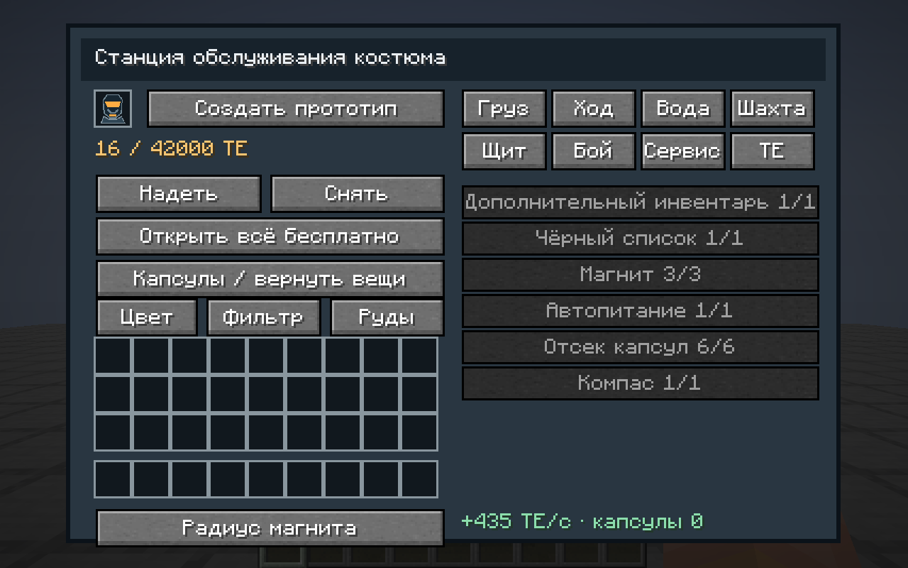
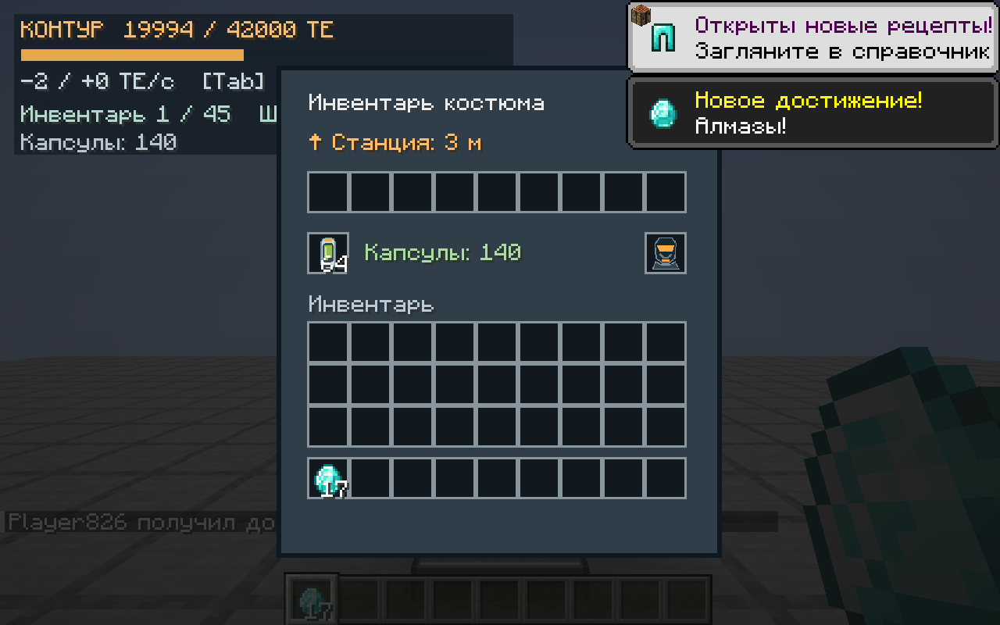
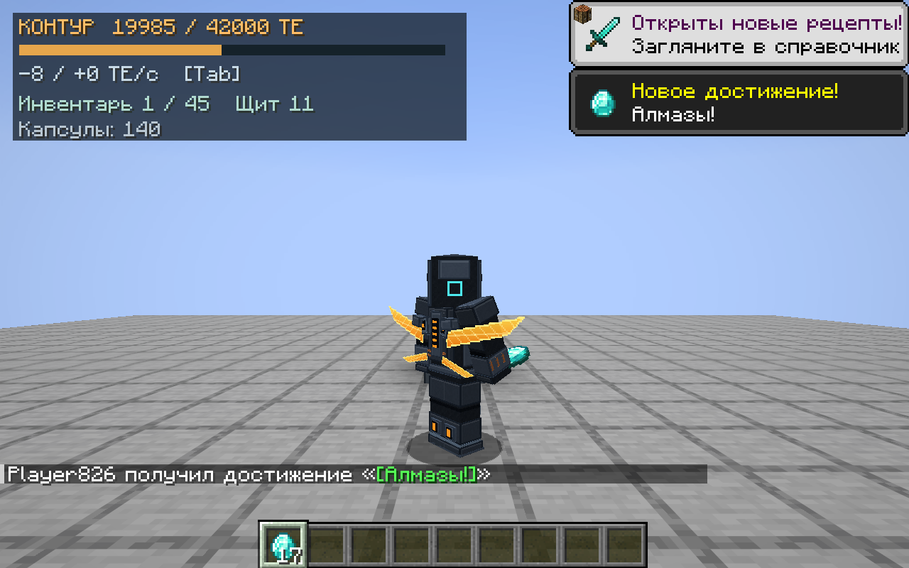
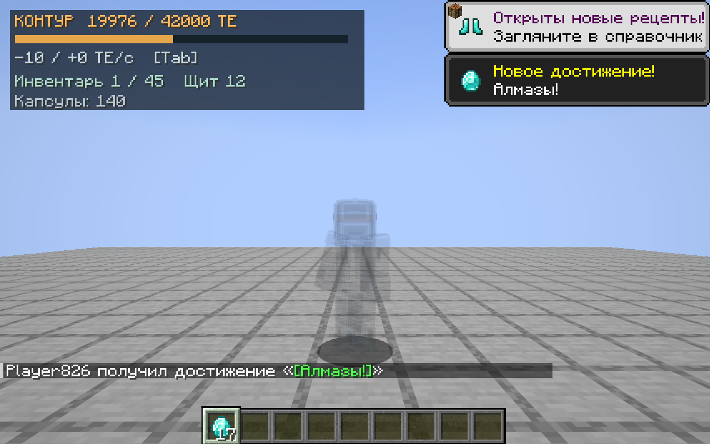

# Костюм «Контур»: функциональная тестовая версия 0.7.0

## Как проверить

1. В творческой вкладке «Контур» взять станцию обслуживания костюма и творческий источник энергии.
2. Разместить станцию; оставить свободным блок над ней. Источник поставить позади станции, его выходом к её заднему входу. Источник имеет выход на стороне, противоположной лицевой панели с символом бесконечности.
3. Открыть станцию, нажать «Создать прототип», затем «Открыть всё бесплатно». Новые костюмы разряжены; кнопку бесплатной зарядки не добавляли — заряд действительно поступает из энергосети.
4. Снять всю обычную броню и нажать «Надеть». Костюм можно заряжать также надетым, находясь рядом со станцией. Для снятия освободить ячейку станции и нажать «Снять».
5. Tab открывает меню функций, V даёт импульс магнита. Все клавиши переназначаются. При ношении список игроков доступен на клавише ` (гравис). E открывает инвентарь костюма; спринт остаётся стандартным спринтом, Shift — приседанием / снижением в гравитационном режиме.
6. В меню Tab кнопка полёта циклически выбирает ранец → элитру → гравитацию → выключено, в пределах открытого уровня. В ранце удерживать пробел в воздухе; в режиме элитры начать штатное планирование, спринт включает разгон; гравитационный режим даёт свободный полёт и ускорение спринтом.

Пока нет стоимости сборки и улучшений: это намеренная тестовая экономика. TODO(crafting): добавить ресурсы, время изготовления, материалы и конечные цены после согласования прогрессии. Все улучшения постоянные и принадлежат экземпляру костюма. Станция универсальная, один рабочий отсек, без привязки к владельцу.

## Энергия

Внутренняя единица и проводка остаются общими с механизмами. Аккумуляторы механизмов по-прежнему имеют 300 ТЕ; костюм использует собственную энергетическую систему поздней игры.

| Параметр | Значение |
| --- | --- |
| Базовая ёмкость | 12 000 ТЕ |
| Ёмкость: 5 уровней | +6000 ТЕ за уровень, до 42 000 ТЕ |
| Зарядка костюма | 64 ТЕ/с базово, +64 за уровень, максимум 384 ТЕ/с |
| Станция | Буфер 4096 ТЕ, задний вход до 512 ТЕ/с, выхода нет |
| Творческий источник | Единственный задний выход до 8192 ТЕ/с, без рецепта и дропа, установка только в креативе |
| Обычный провод | Прежние 10 ТЕ/с; творческий источник не снимает ограничения провода |
| Выходная мощность костюма | 20 ТЕ/тик, +10 за уровень, до 70 ТЕ/тик |
| Экономичность | −8% расхода за уровень, до −40%; аварийное лечение и варп имеют фиксированную стоимость |

HUD показывает запас, фактические расход и зарядку в ТЕ/с, занятость инвентаря, щит и капсулы. Значения расхода — сумма реальных списаний за последние 20 тиков. В Tab есть отдельные строки движения, добычи, защиты, сканеров и поддержки. Детальная точность доступна в меню и по Shift; механизмы не меняют свою прежнюю экономику.

Станция показывает реальный вход и запас; подсказка строки потока дополнительно показывает передачу в костюмы. Техновизор читает запас и поток машин; у провода показывает наиболее нагруженную грань за последнюю секунду. Данные ограничены загруженным миром.

### Начальные стоимости (до экономичности)

- Ранец: 6 ТЕ/с тяги; элитра: 2 ТЕ/с, с разгоном 7; гравитация: 10 ТЕ/с, со спринтом 24.
- Супербег: 0,8 ТЕ/с на уровень; ускоренное плавание: 0,6 на уровень; добыча: 0,06 ТЕ за активный тик; дополнительный блок жилы: 2 ТЕ.
- Сканер руд: 1,6 ТЕ/с; врагов: 1; маскировка: 8; ночное зрение: 0,4; личная яркость: 0,1 на уровень; маяк: 0,8.
- Магнит: 0,5 ТЕ/с, импульс дополнительно 2 ТЕ; капсула питания: 1 ТЕ.
- Щит оплачивает поглощение и восстановление отдельно, расход зависит от урона. Аварийное лечение: 3000 ТЕ. Варп: 1500 ТЕ по успешному завершению.

## Ветки

- **Груз:** девять дополнительных ячеек, чёрный список подбора, магнит до 3 м и импульс 8 м, автопитание, шесть ступеней отсека капсул по 32 до 192, компас к станции последней экипировки. Отсек хранит числовой резерв; извлечённые стаки никогда не превышают 64.
- **Передвижение:** три режима полёта с наклоном камеры, десять ступеней супербега по 10%, подъём на блок только во время супербега, две лёгкие фантомные копии силуэта, отдельные ступени прыжка, снижение урона от падения и ограничение сильного удара до 50% максимального здоровья при достаточной энергии.
- **Вода:** ускорение при спринте, +10% воздуха за уровень, снятие обоих водных штрафов добычи.
- **Шахта:** 20 улучшений по +5% скорости к текущему инструменту; правильность инструмента сохраняется. Сканер руд в сфере 25 м с фильтром любых зарегистрированных руд, добыча связной жилы до 32 дополнительных блоков, личная яркость, личное ночное зрение.
- **Защита:** базовая механическая броня уровня незерита, дополнительные свойства при наличии заряда, ёмкость / стойкость / эффективность щита, отдельные сопротивления магии, снарядам и взрывам, полная защита от горения, снижение взрывного отбрасывания. Лава не приравнена к обычному горению.
- **Бой:** усиление урона, сканер врагов 25 м, предупреждение о преследующем крипере сзади, аварийное лечение до 75% здоровья перед смертью с перезарядкой 300 секунд, маскировка с раскрытием при атаке или получении урона, здоровье цели текстом и полосой.
- **Сервис:** видимый другим игрокам силуэт-маяк, техновизор, возврат к домашней станции после 6 секунд без урона и ближайших монстров, стадия роста растений. Маяк и маскировка взаимоисключающие.
- **Энергия:** ёмкость, зарядка, экономичность и доступная мощность.

Фильтры и цвет настраиваются на станции. Поиск принимает переведённое имя и `namespace:id`, включая предметы других модов; фильтр руд ограничивает каталог рудами. Пустой фильтр руд означает все руды. Чёрный список оставляет предметы в мире, не уничтожает их. Фильтры — до 64 записей каждый.

Синтезированные зелья, их теги, радиационная защита и гены растений будут включены вместе с соответствующими игровыми системами. Пустые кнопки улучшений, изображающие работающую механику, для них не добавлены.

## Сохранение и смерть

Состояние хранится в собственном компоненте предмета: UUID, заряд, уровни, активные режимы, цвет, инвентарь, фильтры, капсулы, домашняя станция, щит и аварийная перезарядка. Перед переносом, сохранением игрока и отключением данные записываются в предмет. Перезарядка аварийного лечения сохраняется также на игроке и не обходится сменой костюма.

Надеть или снять костюм обычным кликом, через броневые ячейки или раздатчик нельзя. Остальные броневые ячейки блокируются; инвентарь содержит один занятый слот костюма. Рука от первого лица остаётся ванильной. Другие игроки видят настоящую модель, цвет, крылья и маскировку надетого костюма.

При `keepInventory=true` костюм остаётся с игроком. Иначе появляется постоянная модель повреждённого костюма с гравитацией. В ней запечатаны обычный инвентарь и вторая рука; встроенный груз остаётся в костюме. ПКМ переносит запечатанный предмет в свободную ячейку, не надевая его. На станции кнопка возврата выдаёт только действительно поместившиеся вещи, остальные остаются внутри. Костюм не исчезает по таймеру, защищён от огня и взрыва; у нижней границы мира удерживается над пустотой.

## Ограничения прототипа

Станция пока имеет простой корпус и платформу, без окончательного художественного оформления. Цены, баланс щита, мощности и всех способностей предварительные. Личная яркость меняет отображение для владельца, не освещает мир и не влияет на спаун. Сканеры работают с загруженными чанками; варп не генерирует и не загружает удалённую станцию. Серверные усиления и расход проверяются сервером.

Сканер проверяет до 1536 позиций за тик, рисует до 256 рудных маркеров и до 64 целей; полное сканирование никогда не выполняется каждый кадр. Магнит обрабатывает до 32 предметов за тик. Жилы ограничены размером и радиусом. Фантомы используют две визуальные копии, не создают сущности.

## Проверки этой версии

`./tools/cloud-gradle.sh build runGameTest`: 40 модульных и 84 серверных проверки.
Клиентский `runVisualTest`: шесть сценариев, включая существующие механизмы,
конвейеры, материалы, естественную генерацию одуванчика, примерку и настоящий костюм.
Функциональный сценарий дополнительно проверен отдельно после исправлений
синхронизации надетого предмета и творческого инвентаря.

Проверены сериализация заряда/груза/фильтров, сохранность при смерти, отсутствие
таймера исчезновения, восстановление при заполненном инвентаре, бюджет энергии,
аварийное лечение с перезарядкой, отключение полёта при разрядке, лимит капсул,
реальная зарядка через сеть, интерфейсы, выбор полёта и работа штатной элитры.

