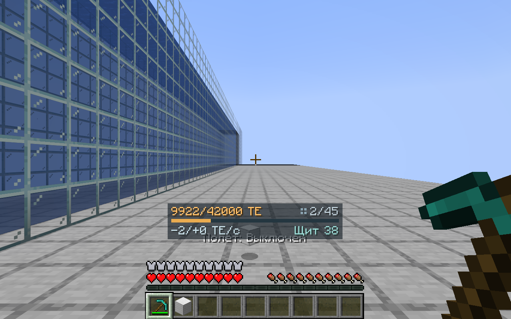
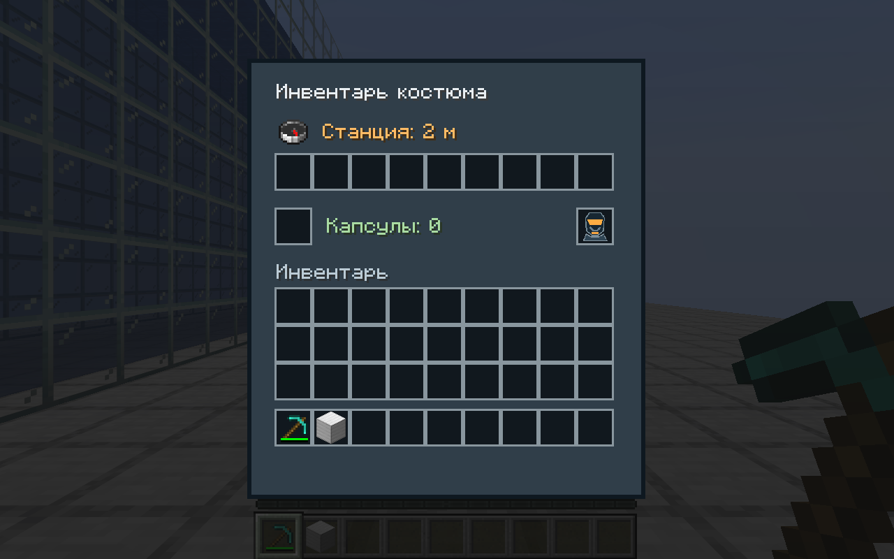
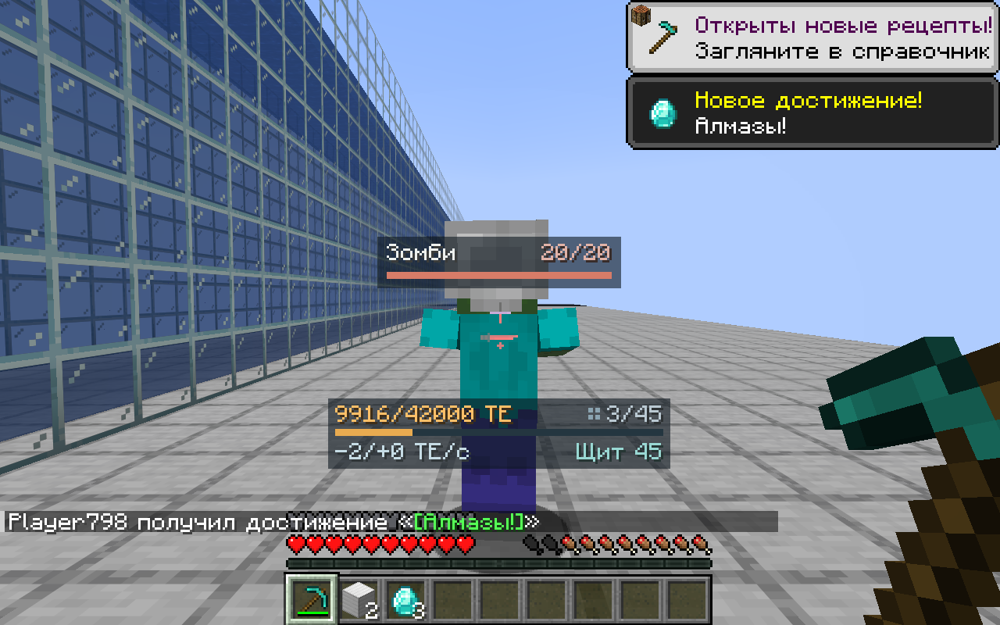

# Контур 0.7.1 — управление и способности костюма

Основная ошибка 0.7.0: у сочетаний мода были числовые коды GLFW вместо кодов SDL,
используемых Minecraft 26.3. Например, для Tab использовался 258, хотя правильный
`InputConstants.KEY_TAB` равен 43. Тесты нажимали ошибочное значение 258, совпадающее
с ошибкой в реализации, и поэтому не обнаруживали недоступность реального Tab.
Исправлены Tab, V, K и G; старые значения заменяются при запуске. Другие
переназначенные пользователем клавиши сохраняются.

Открытие улучшения и включение режима теперь заметно разделены. После открытия
супербег, автопитание и пассивный магнит включены; их можно выключить в Tab.
Полёт исходно выключен и выбирается явно: **Tab → Полёт → нужный режим**.
В интерфейсе показываются текущий режим, запас энергии, доступность улучшений
и реальные клавиши из настроек, а при переключении выводится подтверждение.

- **Супербег:** стандартная клавиша спринта Minecraft (по умолчанию Ctrl) + движение.
- **Прыжок:** пробел во время спринта. Не зависит от того, включён ли супербег.
- **Автоподъём:** только при спринте, независимо от переключателя супербега.
- **Ранец:** удерживать пробел для тяги; можно взлететь с земли обычным прыжком.
- **Элитра:** прыгнуть / сойти с высоты, затем нажать пробел в воздухе; спринт разгоняет.
  Разгон считывает саму клавишу спринта: стандартный флаг бега Minecraft при планировании не устанавливается.
- **Гравитация:** пробел вверх, Shift вниз, движение обычными клавишами. Без вертикального
  ввода высота сохраняется. Касание земли больше не выключает этот режим.
- **Вода:** спринт во время плавания. Каждый уровень даёт +10% к ускорению в воде,
  до удвоения установившейся скорости; толчков только на сервере больше нет.

HUD энергии находится над хотбаром, освобождает центр и верх экрана и скрывается
при открытии интерфейсов. Shift не показывает подробности и не меняет числовую
точность. Подробный расход по подсистемам доступен в Tab. Индикатор цели теперь
компактный, над прицелом. Компас в инвентаре — `minecraft:compass` с компонентом
`LODESTONE_TRACKER`, указывающим на станцию экипировки; рисуется штатная стрелка,
а не текстовая имитация. Если станция находится в другом измерении, стрелка вращается, как у ванильного привязанного компаса.

## Как проверено

Новый клиентский сценарий `SuitMovementTest` запускает полноценный Minecraft
в выживании. Тестовая площадка и заряд задаются как начальные условия. Улучшения
открываются через интерфейс станции; режимы выбираются через настоящее меню Tab.
Далее сценарий удерживает реальные клавиши движения / спринта / прыжка и штатную
кнопку атаки, измеряя координаты и изменение мира. Флаги `flying` и `fallFlying`
для получения успешного результата тестом не устанавливаются.

Отдельно проверяются перенос старой привязки Tab, сохранение пользовательской
привязки F8, действие настоящей V, расход капсулы автопитания и поворот ванильного
компаса при развороте игрока. Серверные проверки сохранности энергии, инвентаря,
смерти и устройств остаются отдельным набором; они не заменяют проверку управления.

Генетика, радиация и синтезированные зелья остаются будущими системами.

## Измерения в выживании

| Проверка | Без улучшения / разгона | С улучшением / разгоном |
| --- | ---: | ---: |
| Бег, путь за 30 тиков | 8,42 блока | 16,83 блока |
| Прыжок при спринте | 1,25 блока | 2,59 блока |
| Плавание, путь за 25 тиков | 4,44 блока | 8,88 блока |
| Скорость добычи алмазной киркой | 8 | 16 |
| Элитра, два участка по 20 тиков | 4,64 блока | 20,85 блока |

У элитры дополнительно проверяется, что персонаж всё ещё планирует во время
измерения и что режим разгона действительно расходует больше энергии.
Проверка добычи не ограничивается чтением скорости: сценарий разрушает железный
блок реальной кнопкой атаки. В измеренном сценарии разрушение заняло 19 и 15 тиков;
при повторном разрушении учитывается штатная пауза Minecraft между блоками.

Ранец поднял персонажа с земли на 17,57 блока за 28 тиков удержания пробела.
В гравитационном режиме после отпускания пробела высота осталась 18,00 → 18,00
за следующие 15 тиков; снижение по Shift проверяется отдельно.

Новый HUD энергии имеет ширину 140 единиц интерфейса и содержит две компактные строки.
Панель цели также уменьшена: имя и HP расположены в одной строке над тонкой полосой.

Проверки завершились успешно: 40 модульных тестов, 84 серверных GameTest,
семь клиентских сценариев. После окончательного уменьшения панели цели
расширенный сценарий управления дополнительно выполнен отдельно.
